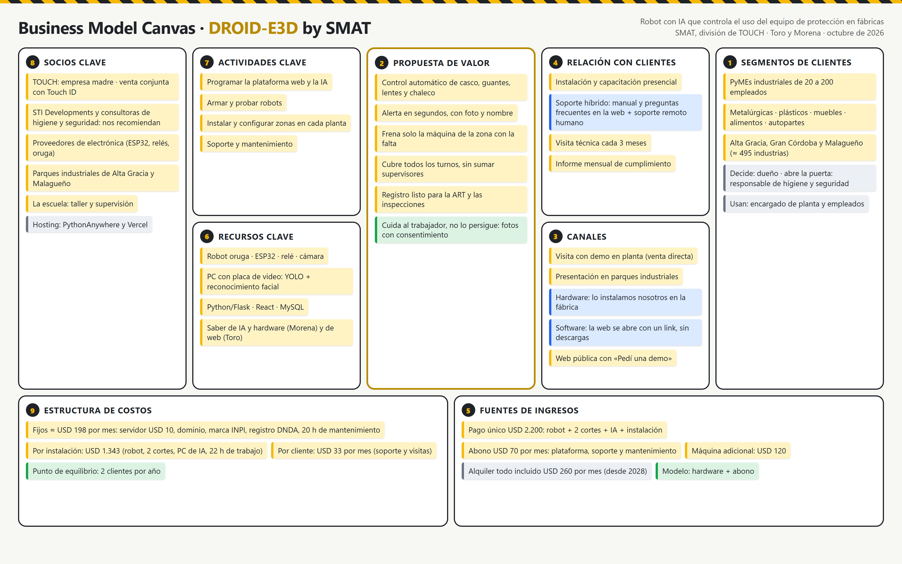

# Business Model Canvas · DROID-E3D

> **Materia:** Emprendimiento · **Profesora:** Tamara Piccinni · **Agencia:** SMAT (división de TOUCH)
> **Equipo:** Toro · Morena · **Actualizado:** 08/10/2026

**Archivos para entregar:** [imagen PNG](canvas/business-model-canvas.png) · [PDF](canvas/business-model-canvas.pdf) ·
fuente editable: [`canvas/business-model-canvas.html`](canvas/business-model-canvas.html)

---

## Lo que debatimos hoy: canales y relación con el cliente

### Canales · ¿cómo llega DROID-E3D al cliente?

DROID-E3D es **hardware + software**, así que tiene dos caminos:

| Parte | Cómo se entrega | Por qué |
|---|---|---|
| **Hardware** (robot, cortes de máquina, PC de IA) | **Lo instalamos nosotros en la fábrica** | El corte de máquina se conecta a la instalación eléctrica (con el electricista de la planta) y hay que configurar las zonas y la ruta del robot en el lugar. No se puede mandar por correo. |
| **Software** (plataforma web) | **Un link**: se abre en la PC o en el celular, sin descargar nada (en noviembre, con la Fase 7, también se podrá instalar como app desde el navegador) | Así todos los empleados lo usan sin pasar por una tienda de apps. |

Para **conseguir** clientes: visita con demo en planta, presentación en los parques industriales y aliados que
ya entran a las fábricas (detalle en `05-los-primeros-10.md`).

### Relación con el cliente · ¿qué pasa después de la venta?

Elegimos un **soporte híbrido**:

| Tipo | Qué incluye | Costo para nosotros |
|---|---|---|
| **Automatizado** | Manual de uso y preguntas frecuentes en la web; la plataforma avisa sola si el robot se desconecta | Casi nulo |
| **Personal** | Soporte remoto en horario laboral (≈ 2 horas por cliente por mes) y **una visita técnica cada 3 meses**; si falla un sensor o el corte de máquina, vamos a la planta | USD 33 por cliente por mes, cubierto por el abono de USD 70 |

**Por qué híbrido:** DROID-E3D es un sistema de **seguridad**: si una máquina no se reactiva o el robot se
detiene, la fábrica no puede quedarse sola leyendo un manual. Pero las dudas comunes («¿cómo cargo un
empleado?») se resuelven con la ayuda escrita, sin gastar horas.

---

## Los 9 bloques en texto

| # | Bloque | DROID-E3D |
|---|---|---|
| 1 | **Segmento de clientes** | PyMEs industriales de 20 a 200 empleados (metalúrgicas, plásticos, muebles, alimentos, autopartes) de Alta Gracia, Gran Córdoba y Malagueño: ≈ 495 industrias. Decide el dueño; abre la puerta el responsable de higiene y seguridad; usan el sistema el encargado y los empleados. |
| 2 | **Propuesta de valor** | Control automático de casco, guantes, lentes y chaleco en todos los turnos; alerta en segundos con foto; parada solo de la máquina de la zona; registro para la ART y las inspecciones. |
| 3 | **Canales** | Venta directa con demo en planta; parques industriales; aliados (STI Developments, consultoras); web pública. Hardware instalado por nosotros; software por link. |
| 4 | **Relación con clientes** | Instalación y capacitación presencial; soporte híbrido (ayuda en la web + remoto humano); visita cada 3 meses; informe mensual de cumplimiento. |
| 5 | **Fuentes de ingresos** | Pago único USD 2.200 + abono USD 70 por mes; máquina extra USD 120; alquiler USD 260 por mes desde 2028. Modelo: hardware + abono. |
| 6 | **Recursos clave** | Robot oruga con ESP32 y cámara; PC con placa de video para la IA; Python/Flask, React y MySQL; el saber de IA y hardware (Morena) y de web (Toro). |
| 7 | **Actividades clave** | Programar la plataforma y la IA; armar y probar robots; instalar y configurar zonas; soporte y mantenimiento. |
| 8 | **Socios clave** | TOUCH (venta conjunta con Touch ID); STI Developments y consultoras de higiene y seguridad; proveedores de electrónica; parques industriales; la escuela; hosting. |
| 9 | **Estructura de costos** | Fijos ≈ USD 198 por mes (servidor, dominio, INPI, DNDA, 20 h de mantenimiento); USD 1.343 por instalación; USD 33 por cliente por mes. Punto de equilibrio: 2 clientes por año. |

Los números salen de `01-viabilidad-comercial.md` y `03-punto-de-equilibrio.md`; el mercado, de
`04-dimension-del-mercado.md`.
