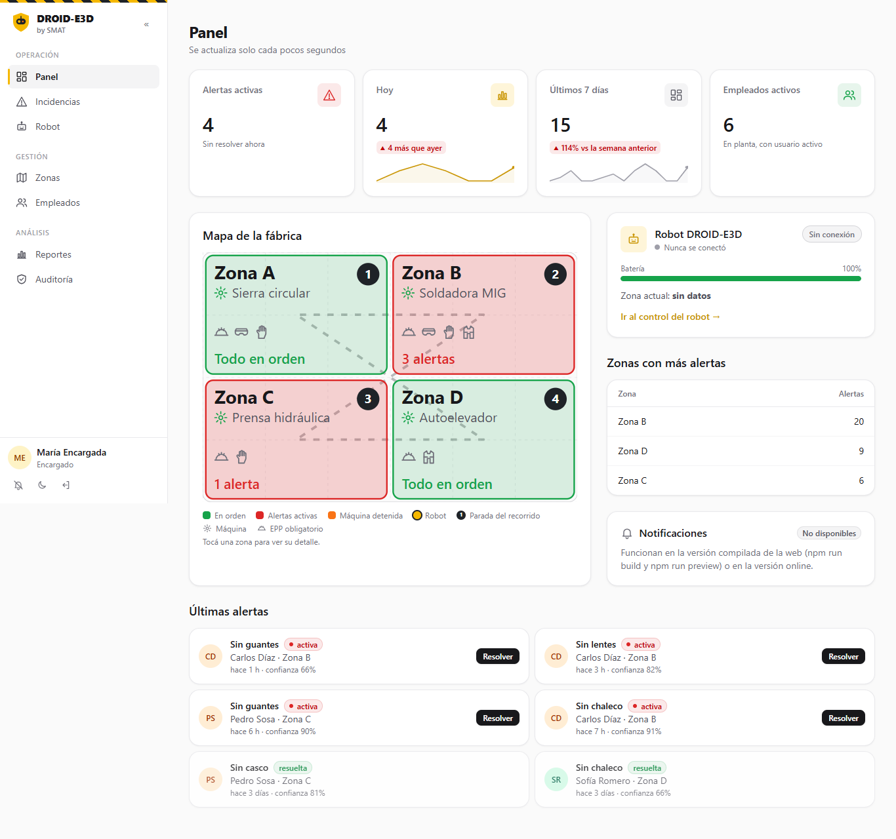
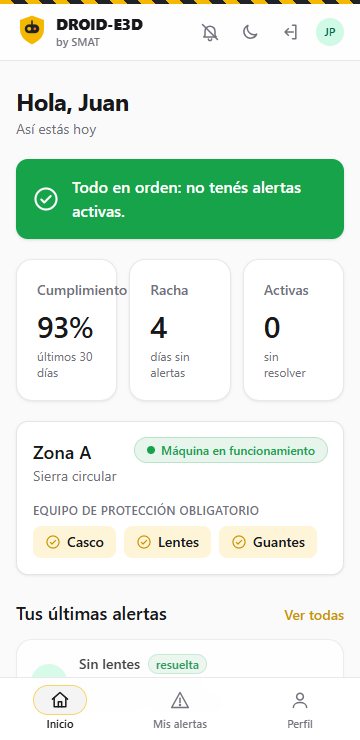
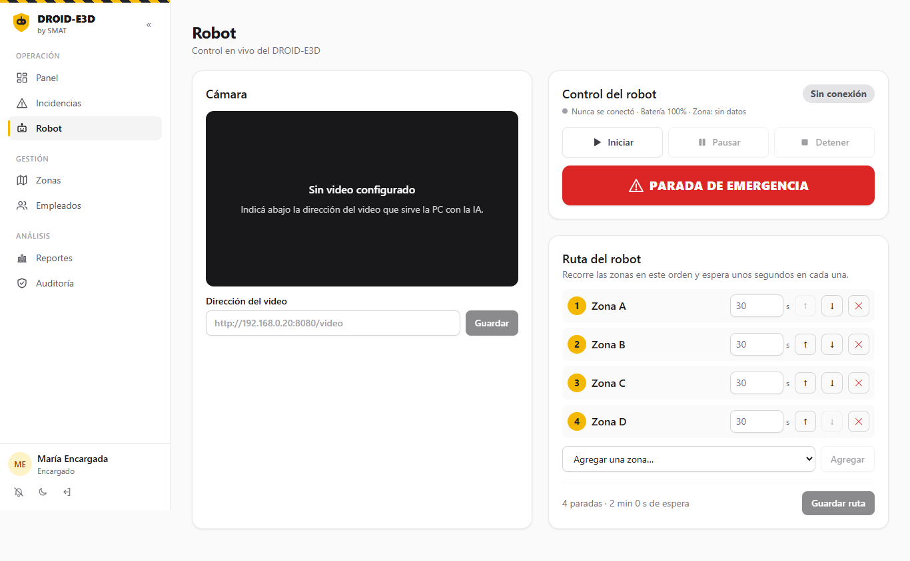
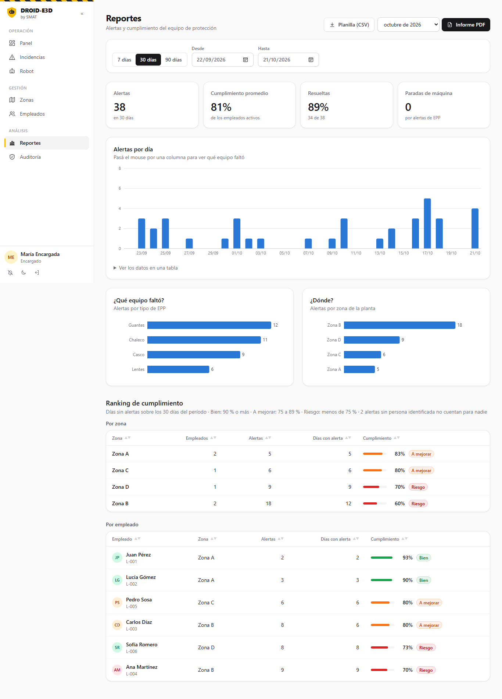

# DROID-E3D · by SMAT

> **SMAT** es una división de **TOUCH**. **DROID-E3D** es su producto: un robot de inspección que usa IA (YOLO)
> para detectar si los empleados de una fábrica usan su equipo de protección personal (EPP), y esta aplicación
> web donde se ven y gestionan las alertas y se controla el robot.

**Documentos:** [Plan de trabajo](docs/PLAN.md) · [API para hardware e IA](docs/API.md) · [Cómo contribuir](CONTRIBUIR.md) ·
[Decisiones técnicas](docs/decisiones/) · [Bitácora](docs/BITACORA.md) · [Fábrica cliente](docs/FABRICA-CLIENTE.md)

## Cómo funciona

```
Cámara → servidor YOLO ──POST /api/incidents──▶ Backend Flask ──▶ MySQL ──▶ Web (React)
                                                     ▲
                       ESP32 del robot y de las máquinas consultan por HTTP cada 1-2 s
```

- **Empleado:** ve el estado de su zona, el EPP que tiene que usar, su cumplimiento y sus alertas (con foto), y puede comentarlas.
- **Encargado:** ve y resuelve todas las alertas, controla el robot (iniciar, pausar, parada de emergencia, ruta, video), detiene y reactiva máquinas, gestiona zonas y empleados, y tiene reportes (CSV y PDF para la ART) y auditoría.
- **Avisos:** cartel y sonido en la web, y notificaciones push al celular o la PC aunque la web esté cerrada.
- **Máquinas (YOLO y ESP32):** no tienen usuario; se identifican con una clave en el header `X-API-KEY`.

## Capturas

Con datos de prueba (empleados ficticios, sin fotos de personas reales).

| Panel del encargado (PC) | Inicio del empleado (celular) |
|---|---|
|  |  |

| Control del robot | Reportes |
|---|---|
|  |  |

Más capturas en [`docs/SMAT/documentacion-final/capturas/`](../../docs/SMAT/documentacion-final/capturas/).

## Demo

- **En la red local** (feria, aula o jurado, sin internet): [`docs/DEMO-LOCAL.md`](docs/DEMO-LOCAL.md).
- **Guion para el jurado** (quién habla, demo paso a paso, plan B y preguntas posibles): [`guion-jurado.md`](../../docs/SMAT/EMPRESA-SMAT/09-presentaciones/guion-jurado.md).
- **Usuarios:** `maria` (encargada) y `juan` (empleado), contraseña `pass123` (ver la tabla de abajo).

## Estado técnico (21/10/2026)

Pruebas automáticas en el repo: **105 de la API** (pytest) y **112 de punta a punta** en el navegador (Playwright), entre ellas el recorrido de las 17 pantallas en celular y PC, en claro y oscuro. Corren solas en GitHub Actions en cada PR.

| Área | Estado |
|---|---|
| Backend: login con roles, zonas, empleados, incidencias (filtros, orden, búsqueda, estadísticas), auditoría | ✅ Funciona |
| Backend: endpoints para YOLO y ESP32 (`/incidents`, `/rostros`, `/robot/*`, `/zones/<id>/maquina`) | ✅ Funciona; falta probarlo con el hardware real (6.5) |
| Backend: parada automática de la máquina al detectar una falta y reactivación por el encargado | ✅ Funciona |
| Backend: foto de evidencia en las alertas y fotos de rostro con consentimiento (Ley 25.326) | ✅ Funciona |
| Frontend: diseño estilo SaaS (claro/oscuro, celular y PC), pantallas del empleado y del encargado | ✅ Funciona |
| Frontend: control del robot con video en vivo, mapa con recorrido, detalle de cada zona | ✅ Funciona con el simulador |
| Página pública de SMAT (`/`, `/como-funciona`, `/planes`, `/nosotros`, `/contacto`) | ✅ Funciona; mail y WhatsApp de contacto en `frontend/.env` |
| Tiempo real: cartel y sonido, web instalable (PWA), notificaciones push | ✅ Funciona (push e instalación en el celular solo con https) |
| Reportes con gráficos y ranking, CSV, PDF mensual, comentarios, auditoría | ✅ Funciona |
| Servidor de IA de Morena (`servidor_ia/`) conectado con la web | ✅ Conectado; falta la prueba real con la cámara y el robot |
| Publicación en internet (PythonAnywhere) | 🔜 Repo listo; falta crear la cuenta (9.3) |
| Hardware (robot, relé, cámara) | En desarrollo por Morena. Mientras tanto: `backend/tools/simular_esp32.py` y `backend/tools/simular_yolo.py` |

El detalle tarea por tarea está en [`docs/PLAN.md`](docs/PLAN.md) y los documentos de la empresa y el reporte de avance en [`docs/SMAT/`](../../docs/SMAT/) (en la raíz del repo).

## Estructura

```
src/SMAT/
├── backend/            Flask + MySQL → puerto 5000
│   ├── app.py  config.py  models.py
│   ├── routes/         auth · incidents · zones · users · robot · rostros · uploads · push · reports · comentarios · auditoria
│   ├── utils/          decoradores.py (sesión, rol, clave de API) · auditoria.py
│   ├── tools/          simuladores (ESP32 e IA), datos de ejemplo, claves push, carga de trabajadores
│   ├── tests/          pruebas de la API (pytest)
│   └── database/       schema.sql (tablas + datos de ejemplo)
├── frontend/           React + Vite → puerto 5173 (compilada, la sirve Flask en el 5000)
│   └── src/            api/client.js (todas las llamadas al backend) · pages/ · components/
├── servidor_ia/        IA de Morena: YOLO + reconocimiento facial → manda las alertas a la web
├── tests/e2e/          pruebas de punta a punta (Playwright) · correr_e2e.py las arranca
└── docs/               PLAN · API · DEMO-LOCAL · DESPLIEGUE · FABRICA-CLIENTE · BITACORA · decisiones/ · integracion/
```

## Cómo usarlo (Windows, PowerShell)

Necesitás: Python 3.11, Node.js LTS y MySQL (alcanza con XAMPP).

### 1. Base de datos
Iniciá **MySQL** desde el panel de XAMPP y cargá el esquema con los datos de ejemplo:
```powershell
cmd /c "C:\xampp\mysql\bin\mysql.exe -u root < backend\database\schema.sql"   # PowerShell no acepta el < solo
```
Para empezar de cero (borra los datos): `C:\xampp\mysql\bin\mysql.exe -u root -e "DROP DATABASE robot_db;"` y volver a cargar el esquema.

### 2. Backend
```powershell
cd backend
python -m venv venv
venv\Scripts\activate
pip install -r requirements.txt
copy .env.example .env
```
Editá `backend\.env`: poné `DB_PASS` (en XAMPP suele estar vacía), un `JWT_SECRET` propio y las dos claves de las máquinas.
Para generar una clave:
```powershell
python -c "import secrets; print(secrets.token_urlsafe(24))"
```
`YOLO_API_KEY` es para el servidor de IA y `ROBOT_API_KEY` para los ESP32. **El `.env` nunca se sube al repo.**
Para las notificaciones push (opcional), generá las claves VAPID una sola vez y pegá las dos líneas en el `.env`:
```powershell
python tools\generar_claves_push.py
```
```powershell
python app.py
```
Probá: http://localhost:5000/api/health

### 3. Frontend (otra terminal)
```powershell
cd frontend
npm install
copy .env.example .env
npm run dev
```
Abrí: http://localhost:5173 . Para entrar desde el celular, poné la IP de tu PC en `frontend\.env` (`VITE_API_URL=http://<IP>:5000/api`) y permití el puerto 5000 en el Firewall de Windows.

**Versión compilada (la misma que se publica):** `npm run build` y abrí http://localhost:5000 (la sirve Flask).
**Demo en la red local** (feria, aula o jurado, sin internet): [`docs/DEMO-LOCAL.md`](docs/DEMO-LOCAL.md).

**Publicar en internet:** todo en PythonAnywhere, paso a paso en [`docs/DESPLIEGUE.md`](docs/DESPLIEGUE.md).

### Usuarios de prueba (contraseña `pass123`)
| Usuario | Rol | Zona |
|---|---|---|
| `maria` | encargado | — |
| `juan`, `lucia` | empleado | Zona A |
| `carlos`, `ana` | empleado | Zona B |
| `pedro` | empleado | Zona C |
| `sofia` | empleado | Zona D |

### Probar el robot sin hardware
```powershell
cd backend
venv\Scripts\activate
python tools\simular_esp32.py --velocidad 10 --maquinas
```
Con el backend y la web andando, entrá como `maria` a **Robot** y tocá **Iniciar**: el robot simulado recorre las zonas, reporta su batería y obedece pausar, detener y la parada de emergencia. Con `--maquinas` también se ve cuándo se «corta» y se «reactiva» cada máquina.

### Probar la integración con la IA sin hardware
```powershell
$h = @{ "X-API-KEY" = "<tu YOLO_API_KEY>"; "Content-Type" = "application/json" }
$body = '{"tipo":"sin_casco","zona_id":1,"empleado_id":1,"confianza":0.93}'
Invoke-RestMethod -Method Post -Uri http://localhost:5000/api/incidents -Headers $h -Body $body
```
Después entrá como `maria` (o como `juan`) y la alerta aparece en la lista. Más ejemplos en [`docs/API.md`](docs/API.md) y [`docs/integracion/`](docs/integracion/).

## Pruebas automáticas

```powershell
cd C:\Users\tomas\Fat\TOUCH-ID\src\SMAT
backend\venv\Scripts\activate
pip install -r backend\requirements-dev.txt      # una sola vez

python -m pytest backend\tests        # 105 pruebas de la API (~30 s), usan la base robot_db_test
python tests\correr_e2e.py            # 112 pruebas con navegador real (~8 min), usan robot_db_e2e
```
Las pruebas **nunca tocan la base de desarrollo** (`robot_db`). Las de punta a punta levantan su propio backend (puerto 5001) y su propia web (5174), y prueban también el robot con el ESP32 simulado.
En GitHub corren solas en cada Pull Request (`.github/workflows/smat-ci.yml`): si algo se rompe, el PR muestra una cruz roja.

## API (resumen)

Todas las rutas llevan el prefijo `/api`. Contrato completo en [`docs/API.md`](docs/API.md).

| Método | Ruta | Quién | Para qué |
|---|---|---|---|
| POST | `/login` · GET `/me` | personas | Iniciar sesión y ver el propio perfil |
| GET | `/incidents` | personas | Alertas (el empleado ve solo las suyas); filtros y paginado |
| POST | `/incidents` | YOLO | Registrar una falta de EPP |
| PUT | `/incidents/:id/resolver` | encargado | Marcar una alerta como resuelta |
| GET | `/stats` | encargado | Estadísticas del panel |
| GET/POST/PUT/DELETE | `/zones`, `/users` | encargado (lectura de zonas: todos) | Gestión de zonas y empleados |
| GET/POST/PUT | `/robot/estado`, `/robot/comando`, `/robot/ruta`, `/robot/video` | encargado | Control del robot |
| GET/POST | `/robot/comando-pendiente`, `/robot/reporte` | ESP32 del robot | Recibir órdenes y reportar estado |
| GET | `/zones/:id/maquina` | ESP32 de la máquina | Saber si la máquina debe estar activa |
| GET | `/rostros` | YOLO | Fotos de rostro (con consentimiento) para reconocer a cada empleado |
| GET/POST/DELETE | `/users/:id/rostros` | encargado o el propio empleado | Ver, subir y borrar fotos de rostro |
| GET | `/uploads/:carpeta/:archivo` | personas o YOLO | Descargar una foto (nunca es pública) |
| GET/POST | `/incidents/:id/comentarios` | encargado y el empleado de la alerta | Conversar sobre una alerta |
| GET | `/reports/diario`, `/reports/ranking` | encargado | Datos de la página Reportes |
| GET | `/reports/incidencias.csv`, `/reports/mensual.pdf` | encargado | Descargas para Excel y para la ART |
| GET | `/auditoria` | encargado | Quién hizo qué y cuándo |
| GET/POST | `/push/clave`, `/push/suscribir`, `/push/desuscribir`, `/push/probar` | personas | Notificaciones push |

## Seguridad
- Contraseñas guardadas con hash (pbkdf2-sha256), nunca en texto.
- El rol se valida **en el backend**, no solo en la web.
- Las máquinas usan claves distintas por función; si falta o es incorrecta, la respuesta es `401`.
- Las fotos de rostro solo se guardan con consentimiento del empleado (Ley 25.326); él mismo puede borrarlas desde su perfil y se borran al darlo de baja. Ninguna foto es pública: se piden con sesión o con la clave de la IA.
